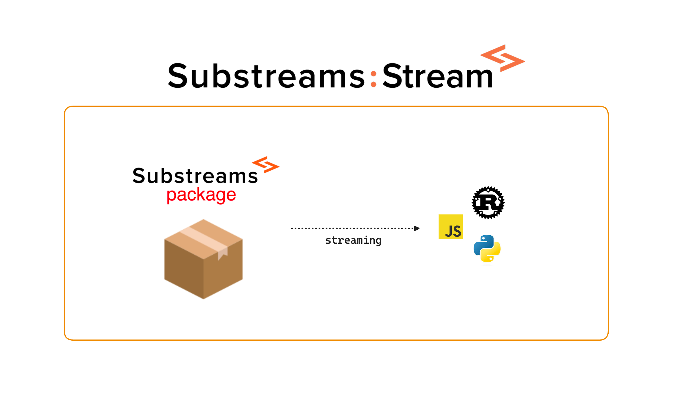

The **gRPC** sink streams blockchain data directly into your own application. Your program connects to a Substreams endpoint over gRPC, receives each block's module output, and keeps the cursor so it can resume after a restart or a reorg.

Examples are available for [JavaScript](./javascript.md), [Go](./go.md), [Rust](https://github.com/streamingfast/substreams-sink-examples/tree/master/rust), [Python](https://github.com/streamingfast/substreams-sink-examples/tree/master/python), and [Java](https://github.com/streamingfast/substreams-sink-examples/tree/master/java) in the [Substreams Sink Examples](https://github.com/streamingfast/substreams-sink-examples) repository.

<figure></figure>
